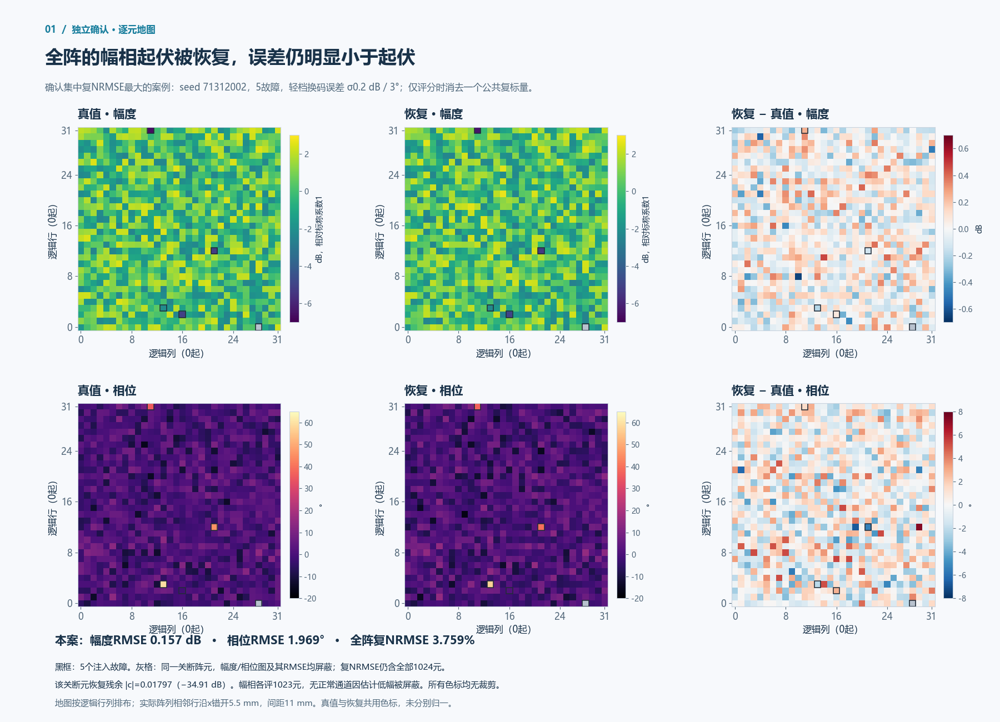

# field2array

Recover relative antenna array element amplitudes and phases from simulated near-field measurements.

This Python project studies how well individual element coefficients can be recovered when amplitudes and phases vary across an array. The current K4 method combines complex near-field scans from four excitation sign patterns: all ones, alternating rows, alternating columns, and a checkerboard. It uses ridge regression, with the regularization parameter selected on separate noisy validation measurements.

The repository also includes [6-DoF position and orientation error models](#6-dof-position-and-orientation-errors) for studying how array displacement and rotation affect near-field reconstruction.

The K4 benchmark covers a known 32 × 32 staggered array at 11.7 GHz. All 20 confirmation cases passed the predefined coefficient-error thresholds under the conditions below. These are simulation results; real measurement data are outside the current scope.

## Install and reproduce

Requires Python 3.10 or later. From a terminal:

```sh
git clone https://github.com/YS-Pan/field2array.git
cd field2array
python -m pip install -e "./experiments/20261027-simulation[test]"
python -m array_reconstruct --help
```

Run the K4 confirmation benchmark from the repository root. It generates its own operators and runs the 20 registered cases; no previous checkout, measurement data, GPU, or local memory service is required.

**Bash / zsh**

```sh
export OPENBLAS_NUM_THREADS=4 OMP_NUM_THREADS=4 MKL_NUM_THREADS=4
python -B experiments/20261027-simulation/scripts/run_k4_research.py \
  --policy experiments/20261027-simulation/configs/k4_confirmation_20261112.json \
  --generate-operators --output tmp/k4-confirmation-reproduction
```

**PowerShell**

```powershell
$env:OPENBLAS_NUM_THREADS = '4'
$env:OMP_NUM_THREADS = '4'
$env:MKL_NUM_THREADS = '4'
python -B experiments/20261027-simulation/scripts/run_k4_research.py `
  --policy experiments/20261027-simulation/configs/k4_confirmation_20261112.json `
  --generate-operators --output tmp/k4-confirmation-reproduction
```

The output directory must not already exist. Results, per-case coefficients, and run receipts are written there. To reproduce the 16 development cases, use `k4_development_20261112.json` and a different output directory. The reference geometry is included in both editable and wheel installations.

The `reconstruct` CLI command is a separate, single-state baseline. Use the script above to reproduce the K4 results.

## K4 results and tested conditions

The confirmation set uses 10 independent random seeds, each with a healthy array and a paired array containing five injected faults: 20 cases in total. All cases completed and passed all three thresholds.

| Metric | Worst across 20 cases | Threshold per case |
| --- | ---: | ---: |
| Element amplitude RMSE | 0.166 dB | ≤ 0.5 dB |
| Element phase RMSE | 1.969° | ≤ 5° |
| Complex coefficient NRMSE | 3.759% | ≤ 10% |

Each row reports its own worst value; the three values need not come from the same case. Scores remove one common complex scalar, so the recovery claim concerns relative element coefficients. A switched-off element is excluded from amplitude and phase RMSE but remains in the full-array complex coefficient error.

| Condition | Confirmation setting |
| --- | --- |
| Array and frequency | Known 32 × 32 staggered geometry, 11.7 GHz |
| Normal element variation | Independent uniform amplitude offsets within ±2.5 dB; Gaussian phase offsets with σ = 5° |
| Excitation | Four coherent sign patterns applied to the same underlying element coefficients |
| Unknown switching errors | Non-reference patterns: Gaussian amplitude σ = 0.2 dB and phase σ = 3°, fixed across training, validation, and test planes |
| Forward and inverse models | Finite-aperture simulated fields; point-source inverse model |
| Noise | Fixed absolute noise per plane, set from the clean uncoded field RMS divided by 100 |

The Gaussian σ values describe distributions, not hard bounds on each element's error. Session drift, other frequencies, unknown geometry, and larger switching errors have not been confirmed. Fault detection has false positives and is assessed separately from coefficient recovery. Passing these finite simulation cases does not establish a general reliability guarantee or validate real hardware.



The figure shows the faulted confirmation case with the largest complex coefficient NRMSE. Existing figures and the [47-second demonstration video](artifacts/runs/k4-visuals-20261112/k4-explained.mp4) have Chinese captions.

The repository includes [metrics for all 36 cases](artifacts/runs/k4-research-20261112/metrics.csv), [confirmation results](artifacts/runs/k4-research-20261112/confirmation/results.json), and [development results](artifacts/runs/k4-research-20261112/development/results.json). The [evidence manifest](devDoc/archive/20261112-github-publication/published-evidence.json) lists the published files and their SHA-256 hashes. Full per-case NPZ archives and historical raw material are retained locally; the full archive manifests also list files that are not distributed in Git.

## 6-DoF position and orientation errors

The pose model describes the six degrees of freedom of one rigid array relative to a fixed scan plane. Element locations remain fixed in the array's local frame. Changing the array pose changes propagation paths and the scalar directional response, which can affect the recovered element amplitudes and phases.

| Coordinates | Meaning | Units |
| --- | --- | --- |
| `d` | Normal distance from the array centroid to the scan plane | mm |
| `dx`, `dy` | Lateral position offsets | mm |
| `alpha`, `beta`, `gamma` | Orientation angles, using the kernel's rotation convention | degrees |

Rotations act about the registered array centroid, with `R = Ry(beta) @ Rx(alpha) @ Rz(gamma)`. The code provides three related components:

- [Pose kernel](experiments/20261027-simulation/src/array_reconstruct/joint_pose_kernel.py): the scalar field model and its first and second derivatives with respect to pose parameters.
- [Independent simulation and error metrics](experiments/20261027-simulation/src/array_reconstruct/joint_pose_virtual.py): `independent_pose_field` generates fields without calling the fitted kernel; `pose_error_metrics` reports descriptive translation and angle errors, the rotation geodesic angle, and the P90 and maximum element displacement.
- [CPU inverse model](experiments/20261027-simulation/src/array_reconstruct/joint_pose_cpu.py): `PoseJointProblem` fits pose and session gains while profiling out complex element coefficients with augmented QR solves.

Historical studies include numerical derivative checks, CPU/GPU consistency checks, and limited pose-recovery development cases. Their results apply to the tested models and settings. The K4 confirmation above uses fixed, known geometry and does not confirm recovery with unknown 6-DoF pose errors. See the [position and orientation study summary](devDoc/tasks/20261112-simulation-research/research/prior-joint-results.md) for the evidence and open questions.

## Validation and documentation

The 2026-11-12 publication checks passed 469 CPU tests and 43 additional tensor CPU interface checks. A full replay of the K4 confirmation command reproduced all 20 cases with identical coefficient-error metrics. CUDA execution was not tested. See the [publication record](devDoc/archive/20261112-github-publication/result.md) for details.

Supporting documentation is currently in Chinese:

| Document | Contents |
| --- | --- |
| [K4 result report](devDoc/tasks/20261112-simulation-research/research/k4-first-version-results.md) | Model assumptions, scoring, per-case evidence, and limitations |
| [Position and orientation study](devDoc/tasks/20261112-simulation-research/research/prior-joint-results.md) | Historical 6-DoF numerical checks, development results, and recovery limits |
| [Simulation route](experiments/20261027-simulation/README.md) | Code entry points, dependencies, CPU test commands, and optional GPU modules |
| [Research plan](devDoc/tasks/20261112-simulation-research/plan.md) | Completed work and open questions |
| [System overview](devDoc/system/overview.md) | Implementation layout and links to historical material |
| [Project charter](devDoc/project-charter.md) | Research goals and scope |

Complete chat logs, user-request originals, local memory databases, credentials, and large raw archives are excluded from public Git. Only the reviewed scientific evidence listed above is included from `artifacts/`.
