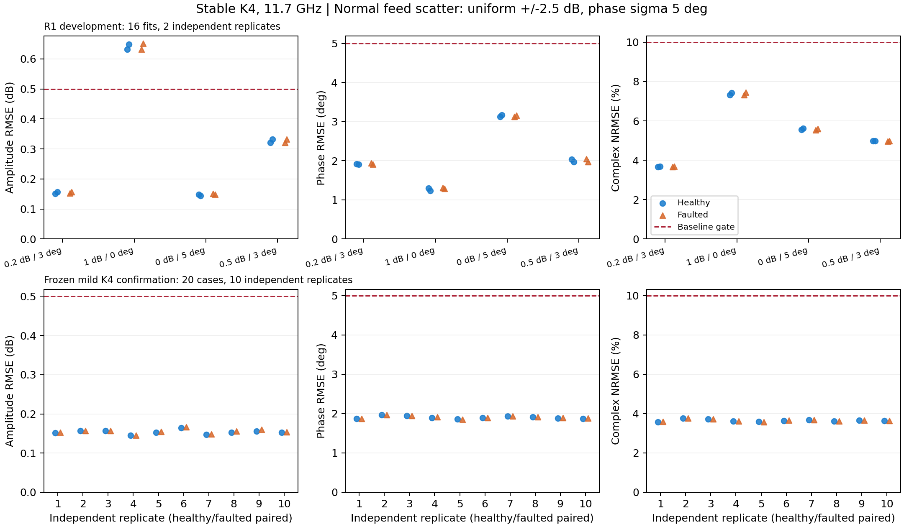
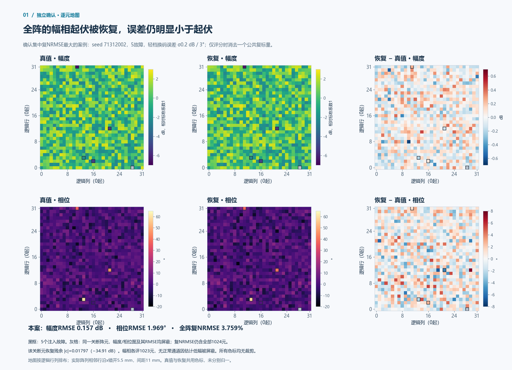
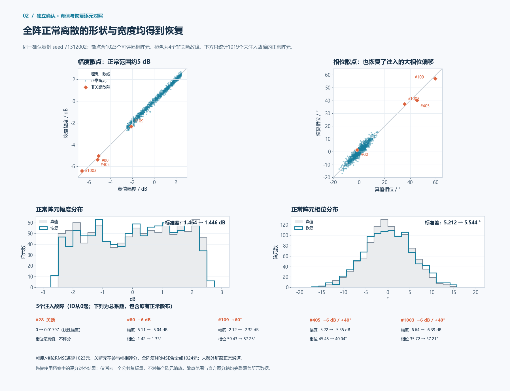
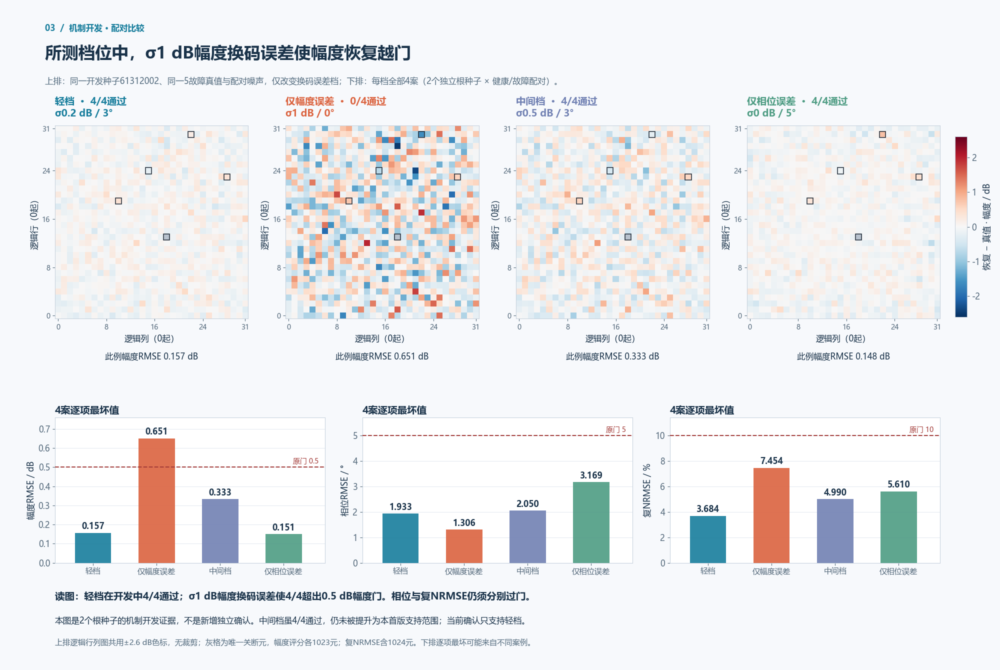

# 稳定K4首版确认结果

2026-11-12，Asia/Shanghai。[执行预登记](execution-registration.md)和两份策略在新科学结果前冻结；本轮完成R1的16次机制开发和R3的20例独立确认，交付R4受限首版。**20例确认全部通过原0.5 dB／5°／10%三项基准，无拒绝、失败、未启动或超时；没有放宽目标。** R2会话漂移等扩展问题仍开放，整份研究计划未据此宣称全部闭合。

## 已支持的条件与方法

11.7 GHz、32×32已知错列阵列；正常幅度独立均匀±2.5 dB、相位独立高斯σ5°；健康及随机5故障配对。K4为全1、隔行、隔列和棋盘四码，相干观测同一个基础系数向量。非参考码各通道未知高斯换码误差σ0.2 dB／3°，跨训练、空间验证和测试固定，参考码不变。σ是分布参数，不是逐通道误差上限。几何、基础响应、会话公共增益/相位均无新增漂移。

训练3969点、独立偏移验证1323点、67 mm测试1323点；四码分别为15876、5292、5292个复观测。每个平面的初始未编码清洁场RMS/100决定固定绝对噪声，弱码态不重新归一到40 dB。真值为0.1λ、3×3积分的有限孔径；逆模型为点源。验证的独立性指空间和噪声，不是另一次硬件会话。

算法直接复用原 `prepare_coded_ridge` / `solve_coded_ridge`：训练拟合公共增益，标称中心ridge，原25点alpha网格只由带噪独立验证选择。未修改物理核、原求解器、历史运行器或旧结果。新 `k4_research.py` 提供当前策略化入口、输入核验、预算、逐案证据与完整分母。

恢复对象是逐元标量等效辐射系数。评分消去一个公共复标量，另报未对齐误差；关断阵元仍进入全阵复NRMSE。确认中健康案1024通道全部评幅相，故障案1023通道评幅相，唯一关断通道屏蔽相位；没有因估计低幅额外屏蔽正常通道。

## 独立确认

10个新根种子 `71312001`–`71312010`，各健康/故障两案，共20案、10个独立重复。与旧种子及开发种子分离；健康/故障有意配对，不当20个独立重复。确认前后方法、策略、阈值及代码哈希一致，没有按R1中间点成绩扩大支持范围。

| 确认组 | 同时过三门/总数 | 幅度RMSE均值／最坏 dB | 相位RMSE均值／最坏 ° | 复NRMSE均值／最坏 |
| --- | ---: | ---: | ---: | ---: |
| 健康 | 10/10 | 0.1535／0.1641 | 1.9027／1.9629 | 3.6484%／3.7540% |
| 5故障 | 10/10 | 0.1549／0.1661 | 1.9041／1.9693 | 3.6498%／3.7593% |

全部20案最坏值为 **0.166144 dB、1.969274°、3.759260%**。未对齐误差最坏为0.166399 dB、1.969337°、3.759414%；公共评分对齐没有掩盖本组的大幅绝对偏差，但本版本仍仅声明相对系数准确性。有限随机确认不构成普遍保证、真实芯片能力证明或95%可靠率认证。

故障诊断单列：10个故障案的50个注入故障全部检出，正常通道误报3个；健康组也误报3个。相同检测器对真值本身在两组各产生1个正常越阈值；按真值越阈值对象评价，各组另有1个漏报和3个误报。旧含检测联合口径为14/20，与本次20/20系数确认不同。因此本首版不宣称注入故障诊断全部达标，也不把正常离散越阈值直接当物理故障。

## R1有界机制开发

根种子 `61312001,61312002`，各健康/故障配对，每个误差档4案；16案全部正常完成。表中误差均为4案逐项最坏值，不是同一最坏案例或统计置信界。

| 换码幅度σ／相位σ | 三门通过 | 最坏幅度RMSE dB | 最坏相位RMSE ° | 最坏复NRMSE |
| --- | ---: | ---: | ---: | ---: |
| 0.2 dB／3° | 4/4 | 0.1570 | 1.9329 | 3.6841% |
| 1 dB／0° | 0/4 | 0.6511 | 1.3055 | 7.4538% |
| 0 dB／5° | 4/4 | 0.1506 | 3.1687 | 5.6097% |
| 0.5 dB／3° | 4/4 | 0.3326 | 2.0501 | 4.9904% |

在所测两重复中，单独加入σ1 dB换码幅度误差已足以使现有方法超出0.5 dB门；单独σ5°换码相位误差未造成三门失败。中间点在开发中通过，支持未来专门确认的候选，不将它事后提升为本首版声明。中间点两组正常通道各误报7个；系数通过不能代替检测通过。此开发没有定位精确最大容限，也没有证明其他算法不可达。按预算做完即停止，没有追加网格或调参。

## 实际检查、代价与证据

- 原7个数值模块与旧源逐字节SHA-256一致；原216,964,232字节算子缓存哈希 `f02f654b7aaedfb13c48fad7012eff33628d8f15220f79d0fb1f78bc3fde6cdc` 与历史编码回执一致。新入口核全点源矩阵，并以独立原模拟器核有限孔径场，均通过5×10⁻¹³相对误差要求。
- 新运行器25项、原编码/大离散41项、逆解/物理36项，共102项相关测试通过；另完成生成算子的小尺寸完整烟测。独立定向审阅通过。本次仅CPU四BLAS线程，不新增GPU数值声明。
- 全规模重建当前合同的6个算子数组，与旧缓存逐数组比较相对差均为0，独立模拟器场核验最大相对误差约7.54×10⁻¹⁶；重建和核对6.45秒，不新增科学案例，见[生成核对记录](../../../../artifacts/runs/k4-research-20261112/generated-operator-verification.json)。
- 12个独立根种子的252个规范随机键无意外重复；组内配对复用为预登记设计。36案全部独立复算系数三项指标、掩膜相关量、归一噪声和固定绝对噪声，核策略/源码/逐案档案哈希，问题0。
- 开发用时11.54秒，确认12.77秒，各包含输入核验、K4直接SVD、拟合、评分和逐案压缩输出；两次SVD各自的条件数约4.955724、rank1024是固定理想逆矩阵的性质，不作为未知状态误差模型普遍可辨识的证明。观测预算仍是四码扫描，计算快不减少测量代价。

选留证据共137文件、76,488,034字节（不含manifest自身），位于[证据清单](../../../../artifacts/runs/k4-research-20261112/manifest.json)。包括[确认原结果](../../../../artifacts/runs/k4-research-20261112/confirmation/results.json)、[开发原结果](../../../../artifacts/runs/k4-research-20261112/development/results.json)、逐案NPZ/JSON、冻结策略、源快照、回执、日志、[独立复算记录](../../../../artifacts/runs/k4-research-20261112/verification.json)和[指标CSV](../../../../artifacts/runs/k4-research-20261112/metrics.csv)。未复制大型旧算子；下方入口可重建。



## 当前复现入口

从项目根执行；输出目录必须尚不存在。使用当前Python依赖环境即可，无需旧项目或实测数据：

```powershell
$env:OPENBLAS_NUM_THREADS = '4'
$env:OMP_NUM_THREADS = '4'
$env:MKL_NUM_THREADS = '4'
python -B 'experiments/20261027-simulation/scripts/run_k4_research.py' `
  --policy 'experiments/20261027-simulation/configs/k4_confirmation_20261112.json' `
  --generate-operators --output 'tmp/k4-confirmation-reproduction'
```

开发替换为 `k4_development_20261112.json` 和新输出路径。已有兼容纯仿真算子时用 `--operators '<绝对NPZ路径>'` 替代 `--generate-operators`；执行回执保存实际输入哈希及核验。本轮全规模科学确认使用哈希一致的旧缓存；另独立执行了全规模算子重建，6个数组与原缓存数值完全一致，生成/加载及运行完整链另有小模型检查。没有为输入重建核对再次消耗确认样本。

这是一条科学复现入口；直接反演已有四码观测可使用 `thesis_coded.py` 的准备/求解API，训练和验证字段形状分别为 `(4,3969)` 与 `(4,1323)`。普通 `reconstruct` CLI仍是原单状态入口，不能据本次结果把单状态反演称为达标。

## 验收与余项

本轮预登记的机制问题已给出有限、可追溯回答，稳定轻档首版的独立确认通过原基准，受限科学版本交付完成。非理想K4的精确容限、跨会话公共变化和逐元漂移、10.7/12.7 GHz、其他正常散布及未知几何仍未确认；不作不可达结论，不把这些开放范围登记为完成。

科学运行结束时尚未发布GitHub。用户随后要求调查并在可行时提交；普通wheel几何打包和安装回执已修正，公开小证据、检查及发布状态见[发布记录](../../../archive/20261112-github-publication/result.md)。本轮工程修正版不改变算法与评分，原确认冻结的[K4源码](../../../../artifacts/runs/k4-research-20261112/source_snapshot/experiments/20261027-simulation/src/array_reconstruct/k4_research.py)保留原回执身份。公开仓库只分发[明确清单](../../../archive/20261112-github-publication/published-evidence.json)中的小结果和媒体，完整manifest还包含仅本机保留的NPZ等文件；历史档案链接也仅在本机归档可用。许可证尚未指定，不扩大本科学计划为实测研究或basePack产品修复。

## 图解与视频（2026-11-12追加）

按用户要求补充3张中文图和[47秒中文字幕视频](../../../../artifacts/runs/k4-visuals-20261112/k4-explained.mp4)（1280×720、24 fps、无配音），另有[动图预览](../../../../artifacts/runs/k4-visuals-20261112/k4-preview.gif)。素材全部来自本次已保存的NPZ/JSON，没有新增科学实验、重选算法或改写原分数；动画仅展示真值/恢复擦拭对照和案例切换，不表示求解器迭代或硬件随时间变化。

详细案例选取确认组中**复NRMSE最大**的 `seed71312002_faulted_mild`，而非表现最好的一例：幅度RMSE0.157 dB、相位RMSE1.969°、复NRMSE3.759%。20案的幅度最坏值0.166 dB来自另一案，不能混成同一案例。所有恢复图使用已归档的单公共复标量评分对齐结果，未对每个阵元分别归一。地图按32×32逻辑行列排布；实际求解仍使用已知错列几何。

第一张比较真值、恢复及误差。真值/恢复共用色标；幅相均评1023个可评分通道，关断通道灰色屏蔽，其恢复残余线性幅度0.01797（−34.91 dB）另列；全阵复NRMSE仍计入全部1024元。误差图范围内无裁剪。图中的逐元误差与本研究的RMSE门槛是不同统计量，个别逐元误差较大不等于整案RMSE超门。



第二张用逐元散点和正常通道分布解释恢复效果：散点总体沿对角线，正常幅度分布没有被压回标称值附近；1019个未注入故障通道的幅度标准差为1.464→1.446 dB，相位标准差为5.212→5.544°。这些是该案例的实现值，并非新增的器件统计。



第三张展示同一个开发种子的配对机制结果：换码幅度σ1 dB时所测4案全部越过0.5 dB幅度RMSE门；其他开发阳性仍不升级为已确认支持范围。上排误差地图共用±2.6 dB色标且无裁剪，下排为各组4案逐项最坏值。



来源、色标、屏蔽、哈希与复算记录见[静态图清单](../../../../artifacts/runs/k4-visuals-20261112/static_manifest.json)、[视频来源说明](../../../../artifacts/runs/k4-visuals-20261112/video-provenance.json)及[图视频总清单](../../../../artifacts/runs/k4-visuals-20261112/manifest.json)。视频的幅度色标下限−8 dB，真值和恢复各1个低幅格用黑色表示；相位和误差按说明屏蔽关断元，所有误差图无数值裁剪。生成脚本另保存在该证据目录，原科学运行的137件证据保持不变。
